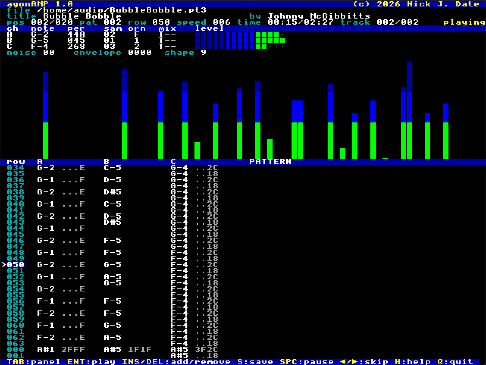

# agonAMP

## Index

- [About](#about)
- [Requirements](#requirements)
- [Installing and Running](#installing-and-running)
- [Obtaining Music Files](#obtaining-music-files)
- [File Formats](#file-formats)
- [Keys](#keys)
- [Features](#features)
- [Settings](#settings)
- [Limitations](#limitations)
- [Building](#building)
- [Licence](#licence)

 

## About

agonAMP is a music player for the Agon Light series of modern retro computers, aesthetically styled on [Open Cubic Player](https://github.com/mywave82/opencubicplayer). It is also a collection of individual libraries that other programs, such as games, can reuse under the very liberal [zlib licence](#licence).

The project plays music written for the AY-3-8912 sound chip of the Amstrad CPC, ZX Spectrum, and other vintage computers. It is written in eZ80 assembly, and runs as an ordinary MOS program.

For more information regarding the reusable libraries, see [lib/README.md](lib/README.md). Otherwise, read on for instructions to install and run agonAMP.

agonAMP was developed and tested in MOS 3.0.2, and VDP 2.16.0.

[Index](#index)

---

## Requirements

- MOS 2.2.0 or later.
 
- VDP 2.5.0 or later.
 
- A screen mode with at least 80 columns, 24 rows, and 16 colours: modes `0`, `3`, `4`, `24`, `27` and `28`. If specified in the configuration file, the screen mode is used. Otherwise it starts in the current mode. `Z` and `X` change the mode while agonAMP runs. The screen mode it was started in is restored on exit.

[Index](#index)

---

## Installing and Running

Copy `agonamp.bin` to `/bin` on the SD card. If you want agonAMP to be able to save its configuration (which is performed automatically on exit), create the folder `/config/agonamp`

Running `agonamp` without any arguments loads the program, and displays the files in the current directory, or, if agonAMP saves its configuration, in the directory the browser was showing when it was last closed (see [Settings](#settings)). It can also be run by specifying a music file or an `.m3u` playlist as an argument.

[Index](#index)

---

## Obtaining Music Files

I found the [ZXART Music](https://zxart.ee/music/search) archive to be the best source of music files to play on agonAMP.

[Index](#index)

---

## File Formats

| Format | Extensions | Notes |
| --- | --- | --- |
| ASC Sound Master | `.asc` | The later kind only (with a loop position). No title. |
| AY files (ZXAYEMUL) | `.ay` | ZX Spectrum music with the Z80 code that plays it, run on an emulated Z80. The songs in a file play one after another, and `P` and `N` move between them; each song's name is shown as the title, with its own time and length, and its number and the number of songs at the right of the first channel line. |
| M3U playlists | `.m3u` | One path per line; `#` lines are comments; paths may be relative to the playlist's directory; LF, CR LF or CR line endings; `\` accepted as a separator; UTF-8 byte order mark skipped. A playlist that cannot be read is reported, and the current playlist is kept. |
| Pro Sound Creator | `.psc` | Title and author shown. |
| Pro Tracker 1 and 2 | `.pt1`, `.pt2` | The module's name is shown as the title. |
| Pro Tracker 3 and Vortex Tracker II | `.pt3` | Title and author shown. |
| PSG register dumps | `.psg` | Both header sizes. `FE n` is read as n * 4 frame ends, as zxtune reads it. |
| Sound Tracker (compiled) | `.stc` | The module's identifier is shown as the title. |
| Sound Tracker Pro | `.stp` | No title shown. |
| SQ-Tracker | `.sqt` | No title. |
| TurboSound (two AY chips) | `.ts`, `.pt3` | Two PT3 modules in one file, or one PT3 module whose second chip plays its patterns mirrored. Six channel lines are shown while one plays. |
| VTX register dumps | `.vtx` | Both header versions. Title, author, clock, frame rate and loop point used. |
| YM register dumps | `.ym` | YM2, YM3, YM3b, YM5 and YM6, packed (LHA `-lh5-`) or not. Title and author (YM5, YM6), clock, frame rate and loop point used. |

PT3, PSG, YM, VTX and AY files are recognised by their contents. The other module formats have no signature, so their files must have the right extension; the header is then checked for sense.

[Index](#index)

---

## Keys

The bottom row lists the main keys. Pressing `H` shows them all.

| Key | Action |
| --- | --- |
| `+`, `-` | Volume up and down (`=` also works for `+`), shown on the bottom row for three seconds |
| `1`, `2`, `3` | Mute or unmute AY channel A, B or C |
| `4`, `5` | Mute or unmute all noise, or the envelope ("buzz") sound |
| `6`, `7`, `8` | TurboSound: mute or unmute channel D, E or F (the second chip) |
| `9`, `0` | TurboSound: mute or unmute the second chip's noise, or its envelope sound |
| `[`, `]` | Playlist: move the selected entry up or down one place |
| `Backspace` | Browser: go up one directory |
| `C` | Playlist: clear |
| `Delete` | Playlist: remove the selected entry |
| `Enter` | Browser: enter a directory, play a music file (adding it to the playlist), or load a playlist. Playlist: play the selected entry |
| `H` or `?` | Show all the keys; `Up`, `Down`, `PgUp`, `PgDn`, `Home` and `End` scroll the list where the screen is too short for it, and any other key closes it |
| `Insert` | Browser: add the selected music file to the playlist and move down one. Elsewhere: open the browser |
| `Left` | Back to the start of the song; within its first 3 seconds, the previous entry |
| `M` | Mute and unmute everything ("mute" flashes on the file line) |
| `N` | AY files: next song in the file, wrapping round to the first |
| `P` | AY files: back to the start of the song; within its first 3 seconds, the previous song in the file (from the first, the last) |
| `Q` or `Esc` | Quit |
| `R` | Shuffle on and off ("shuffle" shows in yellow at the right of the third channel line). `Right` and the end of a song then pick an entry not yet played |
| `Right` | Next playlist entry |
| `S` | Save the playlist |
| `Space` | Pause and resume ("pause" flashes on the status line) |
| `T` | Cycle through colour themes: OCP, Autumn, Iceberg, Emerald, Sand Dune, and Amethyst. |
| `Tab` | Switch the lower panel: playlist, pattern view (tracker modules only), file browser (from which `Tab` goes back to the playlist only if it has entries) |
| `Up`, `Down`, `PgUp`, `PgDn`, `Home`, `End` | Move through the list |
| `V` | Show or hide the spectrum analyser (screens of 40 rows or more) |
| `Z`, `X` | Previous or next screen mode, in the order `0`, `4`, `24`, `28`. |

[Index](#index)

---

## Features

- **Playlist:** up to 255 entries. At the end of a song the next entry plays, wrapping round; with one entry the song loops. An entry that cannot be played turns red, the reason is shown on the bottom row, and the next one is played (the one before, when going back with `Left`); if every entry fails in turn, playback stops. Removing the entry that is playing lets the song play on; `Right` then plays the entry now in its place, and `Left` the one before it.

 

- **Saving a playlist (`S`):** type a name and press `Enter`; `Esc` cancels. It is saved in the directory the browser shows, `.m3u` is added if the name has no extension, and a file of that name is replaced. If the playlist already has a name (loaded from the command line or the browser, or saved before), that name is offered selected: `Enter` saves over the original file (even if the name is too long to be offered in full), typing replaces the name, `Backspace` or `Delete` removes it, and the cursor keys keep it for editing.

 

- **Status lines:** file, title and author, song position, pattern, row and speed (tracker modules), elapsed and total time (the elapsed time stops at 99:59), track number and state, and for an AY file its song number and number of songs.

 

- **Channel lines:** note, tone period, sample, ornament and mixer for each channel, then a level meter coloured by thirds, from low to high, in the colour theme's dark, medium and light colours (blue, bright blue and bright green in the OCP theme). Muted channels are shown in dark grey. Register dumps and AY files show tone periods and levels but no notes.

 

- **Spectrum analyser:** a strip of bars under the channel lines, one column per semitone from C1 (32.7 Hz) on the left to F#7 (2960 Hz) on the right, coloured by thirds of its height, from low to high, in the colour theme's light, medium and dark colours (green, light blue and dark blue in the OCP theme). It is shown while a song is loaded (playing or paused), on screens of 40 rows or more (modes 0 and 24), unless `V` has turned it off, which the settings file remembers; while it is shown the lower panel is 17 rows shorter, and while no song is loaded the panel has the room. The VDP makes the sound, so there is no audio to measure: the bars are worked out from what is sent to the VDP each frame. Each tone that is heard lights the column of its pitch, as high as its level (on the meters' scale), with smaller bars for the harmonics of its waveform (the 3rd and 5th of a square wave); the envelope played as a waveform does the same; noise raises every column a little. Bars fall back gradually. Muted channels light nothing.

 

- **Pattern view:** for PT3, PT2, PT1, STC, STP, ASC, SQT and PSC modules, including TurboSound (six columns). The current row stays in the middle and the rows scroll past; the following pattern is shown below the last row. Each cell shows the note and, where the format records them, the sample, envelope, ornament and volume.

 

- **Muting:** stays in force from song to song.

 

- **Volume:** 16 steps of the VDP's overall volume, read at start-up and put back on exit.

 

- **Clock and frame rate:** YM and VTX files play at the AY clock and frame rate they were made for (clocks from 1 to 2 MHz; 25 to 400 frames a second). Everything else uses the ZX Spectrum's clock (1773400 Hz) and 50 frames a second.

 

- **Timing:** the screen is drawn in small pieces paced by the VDP, so on a slow VDP the display falls behind before the music does. When the cursor moves past the top or bottom of a list, the list is scrolled by one line and only the lines that change are drawn.

 

- **Colours:** agonAMP sends VDU 20 at start-up, so the screen mode's own colours are used whatever palette changes were made before it ran, then sets its colour theme; it sends VDU 20 again on exit.

[Index](#index)

---

## Settings

If the file `/config/agonamp/agonamp.conf` exists, its settings are used at start-up; on exit, the settings in force are written to it. If the file does not exist but the directory `/config/agonamp` does, the file is created on exit. If neither exists, nothing is saved (create the directory to turn saving on). The file is text, one setting per line, written as name=value with no spaces before the `=` and, after it, a whole number from 0 to 255 (a path for `directory`):

| Setting | Meaning |
| --- | --- |
| `mode=0` | Screen mode to start in (used if it is one agonAMP can use; otherwise the current mode is used) |
| `analyser=1` | 1 to show the spectrum analyser where the screen has room, 0 not to |
| `shuffle=0` | 1 to start with shuffle on |
| `volume=127` | The VDP's volume, 0 to 127, while agonAMP runs (the volume found at start-up is put back on exit) |
| `theme=0` | Colour theme: 0 OCP, 1 Autumn, 2 Iceberg, 3 Emerald, 4 Sand Dune, 5 Amethyst |
| `directory=/` | The directory the file browser was showing on exit, where it starts the next time. It is passed over without a message, and the browser starts in the current directory, if it is not an absolute path (starting with `/`) to a directory that can be opened, or is longer than 298 characters. MOS's current directory is not changed, so a relative path given as an argument is still taken from the directory agonAMP is run from |

Other lines, such as `#` comments, are ignored, as are settings that are out of range or malformed. Every setting is given its default before the file is read, so one that is missing, out of range or malformed keeps it: the analyser on, shuffle off, the OCP theme, the screen mode and volume as they were when agonAMP was started, and the browser in the current directory. LF and CR LF line endings are accepted, and the last line need not have one; the file is written with LF line endings and none after its last line. The file is rewritten on exit, so comments and unknown lines are not kept.

[Index](#index)

---

## Limitations

- **Sound:** an approximation of an AY through the VDP's audio channels, not an emulation. Output is mono: the VDP has one audio output, and on the Agon Light, Agon Light 2 and Origins Edition both sides of the audio jack carry it, so the Amstrad CPC's split of the channels between left and right cannot be copied. Quiet levels lose detail, and TurboSound tunes play at about half the level of one-chip tunes. Tone plus noise on one channel is played as a mix, not the AY's logical AND. Noise matches the AY's rate but not its sound. Tones above about 8 kHz are silent. Sampled sound played through the volume registers is not reproduced.

 

- **YM:** the YM5 and YM6 special effects (digidrums, SID voice, Sync Buzzer and the like) are not reproduced; YM4 files are not supported.

 

- **VTX:** the stereo layout and the YM chip flag are ignored.

 

- **AY files:** songs of unknown length get 3 minutes; music that keeps the Z80 busy for most of a frame (sampled sound) does not play properly; beeper music and files for other machines (Amstrad CPC) are silent.

 

- **Formats not supported:** ASC Sound Master 0.x (`.as0`), CPC AYC (`.ayc`), Fast Tracker (`.ftc`), Global Tracker (`.gtr`), Pro Sound Maker (`.psm`), Sound Tracker 1 source (`.st1`), Sound Tracker 3 (`.st3`), Vortex Tracker II text (`.txt`).

 

- **Sizes:** music files up to 256 KB; YM and VTX files only if the file and its unpacked data together fit in 256 KB; AY files up to 192 KB; playlists up to 255 entries and 32 KB; directory listings up to 500 entries; saved playlist names up to 40 characters.

 

- **Pattern view:** effects, noise and envelope periods are not shown; there is no view for PSG, YM, VTX and AY files; for a two-module TurboSound tune the second chip's columns are empty when the two modules are at different positions.

 

- **Screen:** only 80 columns are used. In the shorter screen modes the help list has to be scrolled and the spectrum analyser cannot be shown. VDPs up to Console8 VDP 2.5.0 ignore VDU 19 in the 64-colour modes (3 and 27), so with those the OCP theme is shown there whichever is chosen.

 

- **Spectrum analyser:** it shows the notes being played and the harmonics their waveforms are known to have, not a measured spectrum of the sound, so sampled sound played through the volume registers shows only as bars going up and down.

 

- **Speed:** whole lists are drawn as full-width lines, which is slow on a real VDP; reading a large directory or loading a large file pauses the music briefly.

 

- **Paths:** the path of a directory, or of a playlist file, may be up to 298 characters; a longer one is refused with a message, and a current directory longer than that starts the browser at the root. MOS limits the command line, and so a path typed on it, to 255 characters. (fab-agon-emulator reads no more than 256 characters of any path, so longer paths fail there.)

 

- **Damaged files:** files are checked as far as their formats allow, but not every kind of damage has been tried.

[Index](#index)

---

## Building

The same sources build on a PC and on the Agon with [ez80asm 2.3](https://github.com/AgonPlatform/agon-ez80asm); the two builds are byte for byte identical. The assembler must be run from the `src` directory, because the sources include `../lib/` files. On the Agon, ez80asm 2.3 keeps a record of every reference to a label that is not yet defined, and runs out of memory (the Agon resets) if there are too many; so each source file defines its variables before its code (except `agonamp.asm` and `files.asm`, as their variables come last in the program, and are left out of `agonamp.bin`). Keep new variables with the others at the top of their files.

- **On a PC:** build ez80asm, then run `make` (or `make EZ80ASM=/path/to/ez80asm`).

- **On the Agon:** copy `src` and `lib` side by side (for example `/agonamp/src` and `/agonamp/lib`) and put `ez80asm.bin` in `/bin`. Then `cd /agonamp/src` and run `ez80asm -m agonamp.asm agonamp.bin`. The `-m` option is required.

[Index](#index)

---

## Licence

agonAMP and its sound library are under the zlib licence; see [LICENSE](./LICENSE).

[Index](#index)